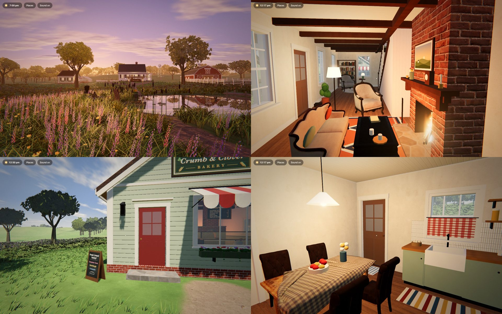

# Hannah ka Ghar

A small farm at sundown that you can walk around in, in the browser. A white farmhouse on a gentle hill with two floors to explore, Crumb & Clover the bakery, a red barn with horses in the paddock, a pond with ducks and a rowboat, a rope swing, an orchard, a garden and greenhouse, and a windmill on the hill. Time passes from golden hour into a starry night.



Built with three.js (WebGL2). The land, sky, trees, buildings, cat, hens and ducks are made in code. The horses are CC0 Quaternius models; the furniture is photoscanned CC0 Poly Haven models, and the leaves, bark, grass clumps, flower heads, siding, brick, roof, floors, plaster and tiles use CC0 Poly Haven textures; sounds are public domain or CC0 recordings. See `CREDITS.md`.

## Run it

```bash
npm install
npm run dev
```

Then open http://localhost:5247 (or your Mac's address on port 5247 from an iPad on the same Wi-Fi).

## Controls

- **Laptop:** click to walk in. `W A S D` walk, `Shift` run, `Space` jump, mouse to look, `E` or click to use things, `Esc` frees the mouse, `T` moves the clock on an hour.
- **iPad:** left thumb walks (push further to run), right thumb drags to look, tap things to use them, or press the button that appears.
- Top left: the clock (open it for time presets, a slider and pause), **Places** to jump around the farm, and sound on or off.

## Things to do

Open and close doors, climb the stairs to the attic, light the fireplace, sleep till morning, take bread from the bakery and eat it, toss crumbs to the ducks, pet the horses and Chai the cat, sit in the Adirondack chairs, the rocking chairs, the rowboat and the swing, light the campfire, open the barn doors and the paddock gate, and stay out for the fireflies and shooting stars.

## How it is built

| Path | What it does |
|---|---|
| `src/main.ts` | Renderer, sun and shadows, the day cycle, the loop, adaptive resolution, holding and eating things |
| `src/sky.ts` | Analytic sky, clouds, sun, moon, a starry night with the Milky Way and shooting stars, time-of-day keys |
| `src/shaderlib.ts` | Shared uniforms, `patchMaterial` (fog, wind, shader lamps, indoor ambient) |
| `src/world/terrain.ts` | Height function, flat building pads, the pond basin, ground masks and the ground shader |
| `src/world/grass.ts`, `flowers3d.ts` | Grass blades, real grass clumps and wildflowers in chunks around the player; 3D flowers up close, cards further out |
| `src/world/trees.ts` | Procedural oaks, fruit trees and tree belts with real leaf clusters and bark |
| `src/world/water.ts` | Pond with planar reflection, lily pads and cattails |
| `src/world/props.ts` | Split-rail fence and the gate sign, Adirondack chairs and campfire, dock and rowboat, rope swing |
| `src/build/` | Building kit (walls with real holes, windows, doors, stairs, roofs), procedural materials, the house, bakery, barn, garden, greenhouse, windmill |
| `src/life/` | Horses, the cat, hens, ducks, birds, bats, fireflies, butterflies |
| `src/physics.ts`, `player.ts`, `interact.ts` | Walking, collisions, stairs, sitting, and things you can use |
| `src/lamps.ts`, `audio.ts`, `ui.ts` | Shader lamps, positional sound, the start screen and HUD |
| `tools/shoot.cjs` | Headless Chrome screenshots and timings for QA |

`BUILDING.md` documents the building kit. Every push to `main` deploys to GitHub Pages (`.github/workflows/pages.yml`).
